# Stage 1: Active Directory, DNS & Group Policy

**Goal:** build a working Windows domain from scratch, with a realistic OU structure, users, security groups and Group Policy, and prove it all works on a domain-joined client.

**Result:** domain `lab.local` running on DC01, 20 users across 4 departments, 3 GPOs, all verified on a Windows 11 client (WS01).

## 1. Build and promote the domain controller

- Installed Windows Server 2025 (Desktop Experience) in VMware, static IP `192.168.59.10`, DNS pointing to itself (`127.0.0.1`).
- Renamed the server to DC01 and took a snapshot before promotion as a rollback point.
- Installed AD DS and created a new forest:

```powershell
Install-WindowsFeature AD-Domain-Services -IncludeManagementTools
Install-ADDSForest -DomainName "lab.local" -DomainNetbiosName "LAB" -InstallDns
```

- Added DNS forwarders (1.1.1.1, 8.8.8.8) so domain clients can resolve internet names.

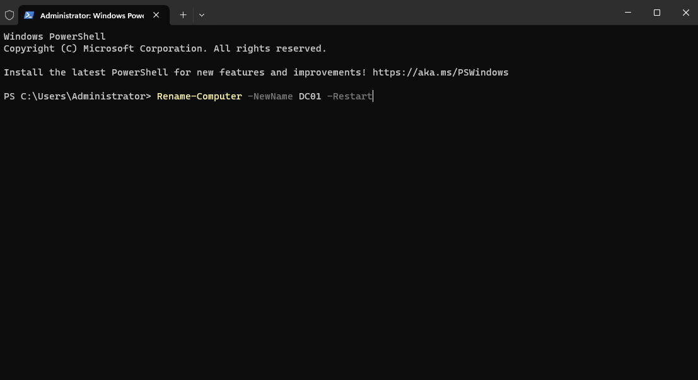
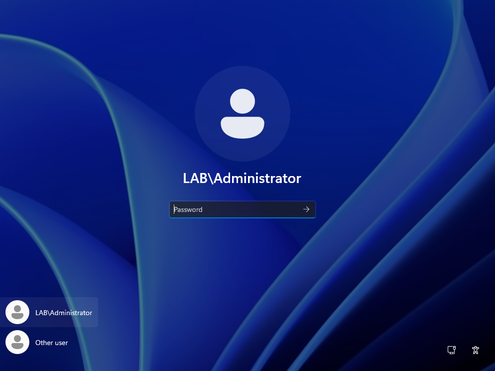
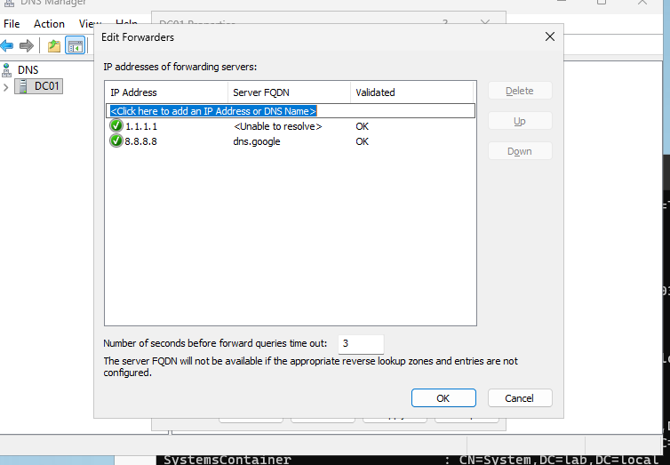
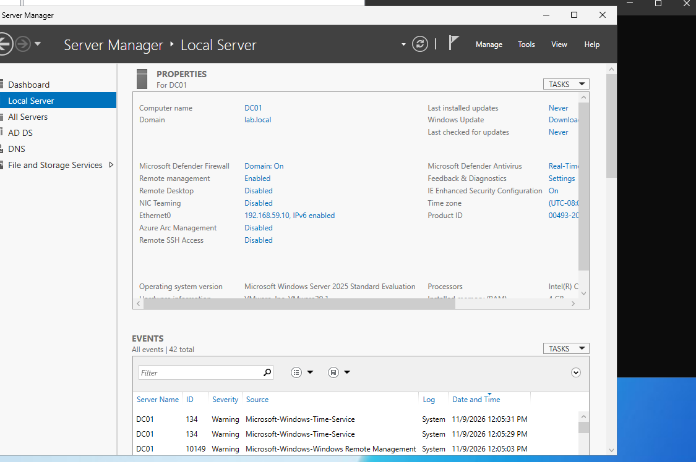

## 2. OUs, users and groups

- OUs: `Workstations`, `Staff`, `Groups`.
- Created the first users and groups by hand in ADUC, then bulk-provisioned the rest with PowerShell (see [`scripts/`](scripts/)).
- One global security group per department (`GG_Finance`, `GG_Sales`, `GG_IT`, `GG_HR`). Membership is populated automatically from each user's Department attribute.

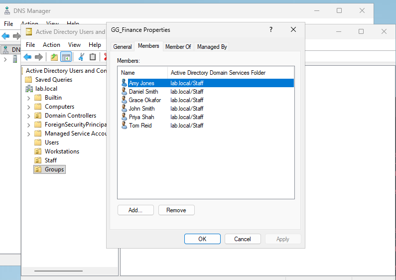

## 3. Group Policy

| GPO | Linked to | What it does |
|---|---|---|
| Default Domain Policy | Domain | Min password length 12, history 24, complexity on, lockout after 5 attempts |
| Drive Map - Company | Staff OU | Maps `S:` to `\\DC01\Company` (Group Policy Preferences) |
| Desktop Lockdown - Sales | Staff OU, filtered to `GG_Sales` | Blocks Control Panel/Settings, Command Prompt and Registry Editor |

Key points:
- Domain password policy only takes effect at **domain level**. Linking it to an OU does nothing for domain accounts.
- For the Sales lockdown I removed Authenticated Users from Security Filtering and added `GG_Sales`. I then gave **Authenticated Users Read** on the Delegation tab, because computers must be able to read a GPO even when it doesn't apply to them, otherwise it fails silently.

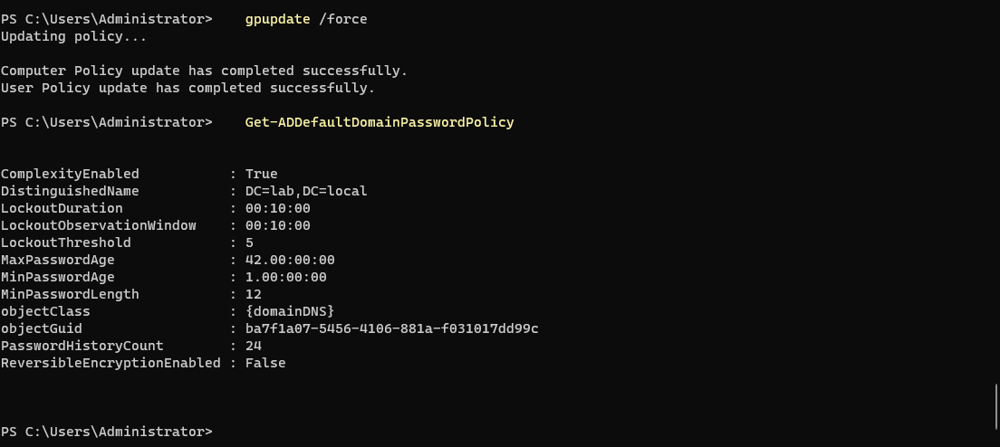
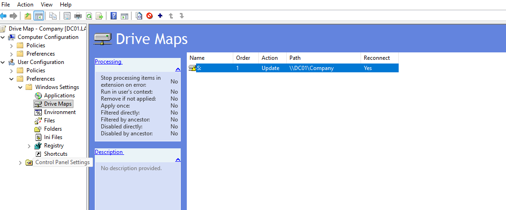
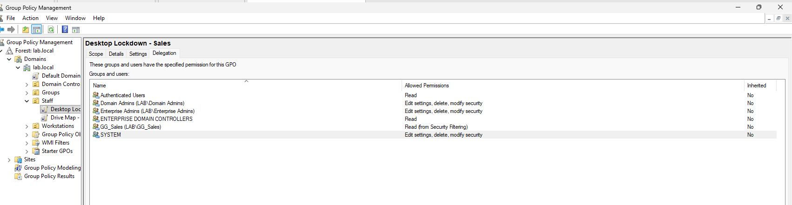

## 4. Join a Windows 11 client and verify

- WS01: static IP `192.168.59.20`, DNS set to **DC01 (192.168.59.10)**, which is what allows the PC to find the domain.
- Confirmed the DC's SRV record before joining, then joined straight into the Workstations OU:

```powershell
nslookup -type=SRV _ldap._tcp.dc._msdcs.lab.local
Add-Computer -DomainName lab.local -OUPath "OU=Workstations,DC=lab,DC=local" -Credential LAB\Administrator -Restart
```

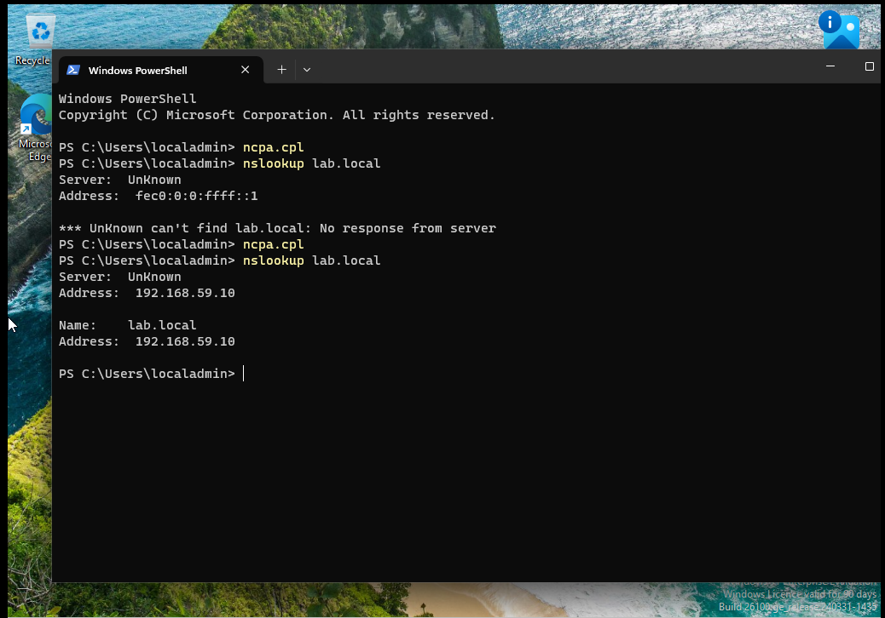
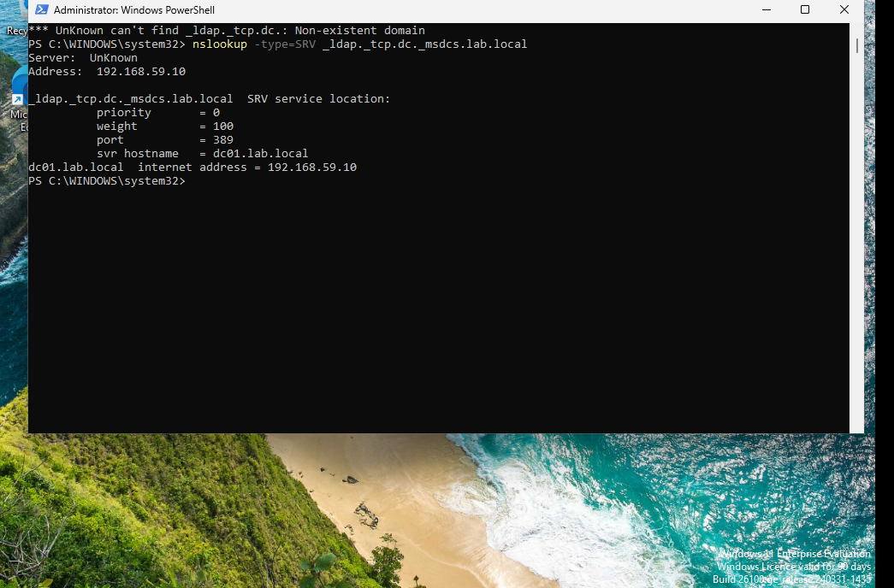
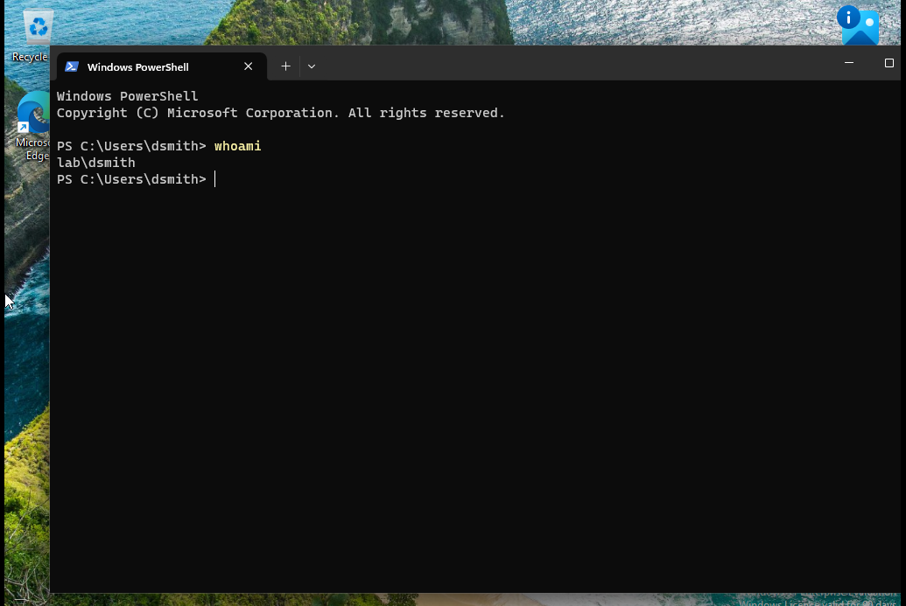

**Verification:**
- Finance user (dsmith): `S:` drive mapped; `gpresult /r` shows the Sales lockdown **filtered out (Denied – Security)**.
- Sales user (kpatel): Command Prompt blocked with *"The command prompt has been disabled by your administrator."*

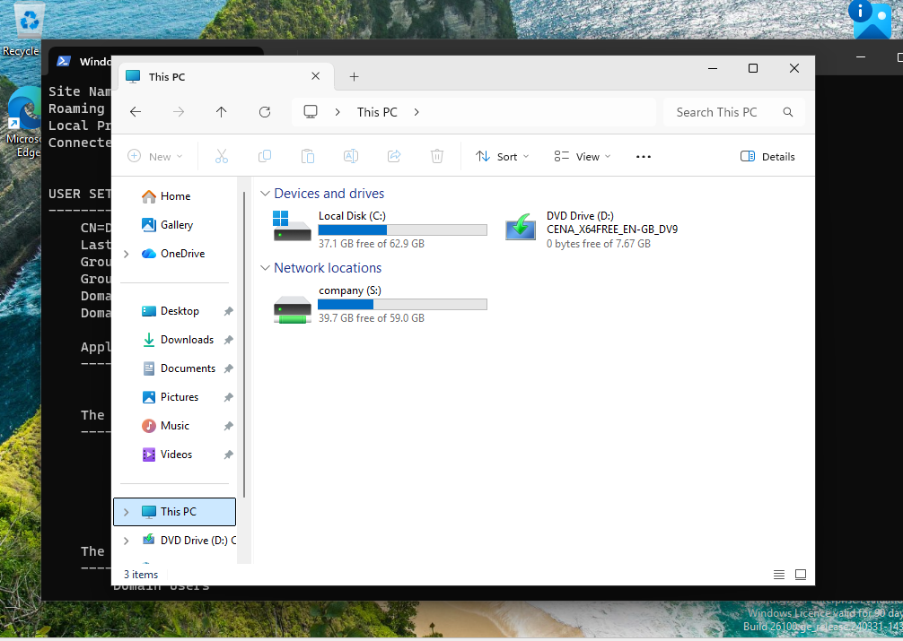
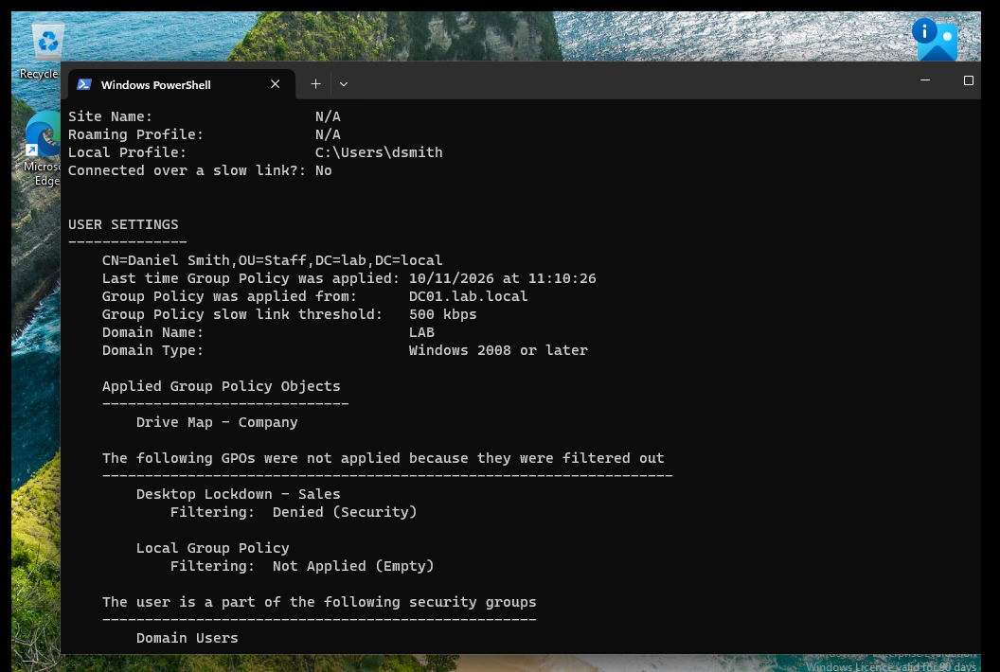
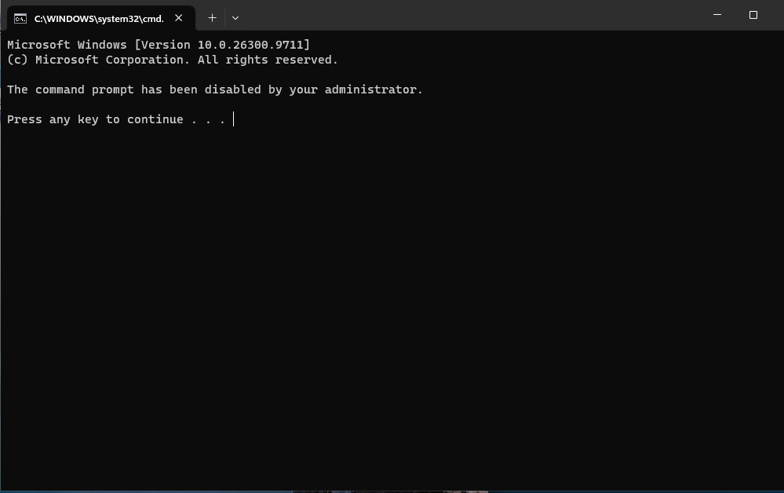

## Problems I hit and fixed

| Problem | Cause | Fix |
|---|---|---|
| VM booted to "EFI Network… timeout" | Missed the 5-second "Press any key to boot from CD/DVD" prompt | Clicked into the VM window immediately on power-on |
| Domain admin password rejected | Typed the letter O instead of zero | Revealed the password with the eye icon to check what was typed |
| User script created no users | Pasting a multi-line block starting with `Read-Host` made it consume the next pasted line as the password | Ran the password line separately; later made the script skip existing users and print a result per user |
| New users not visible in ADUC | ADUC doesn't refresh automatically | F5 |
| SRV lookup said "Non-existent domain" | Typo in the record name (`rcp` instead of `_tcp`) | Corrected the command |
| Windows 11 Enterprise setup rejected a personal Microsoft account | Enterprise setup only accepts work/school accounts | Used **Sign-in options → Domain join instead** to create a local admin account |
