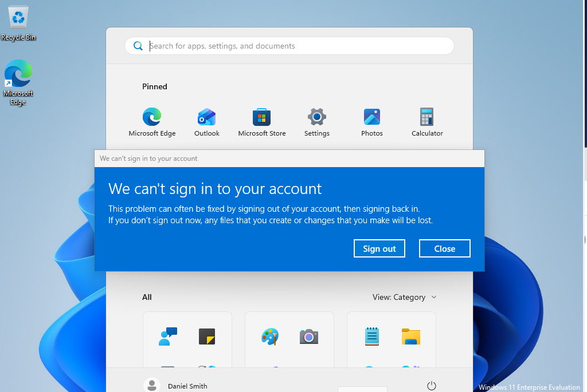
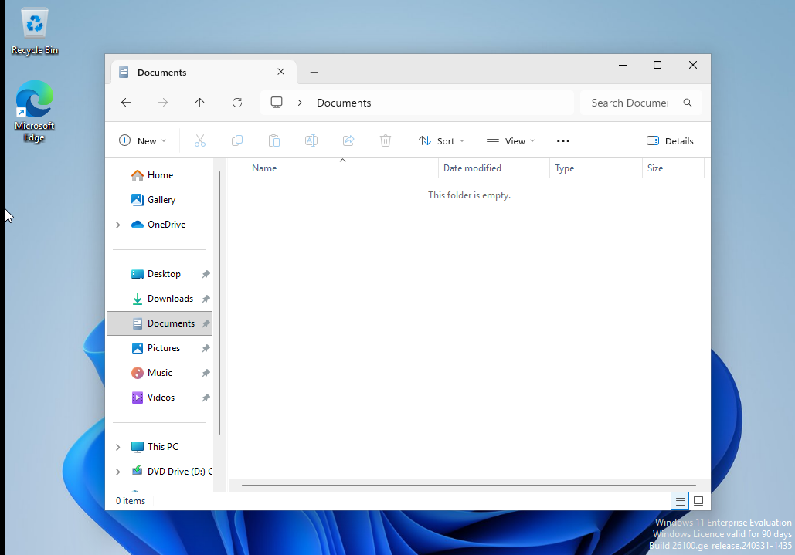
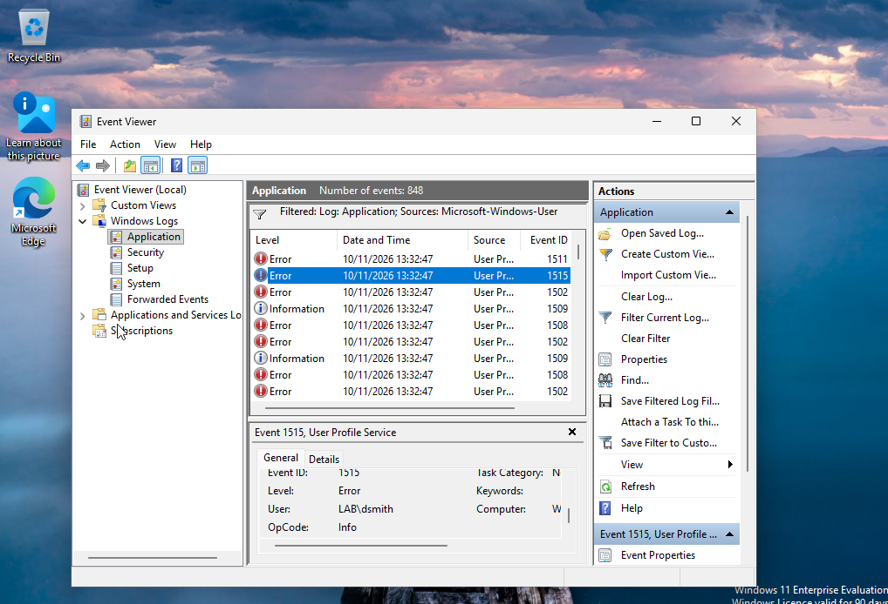
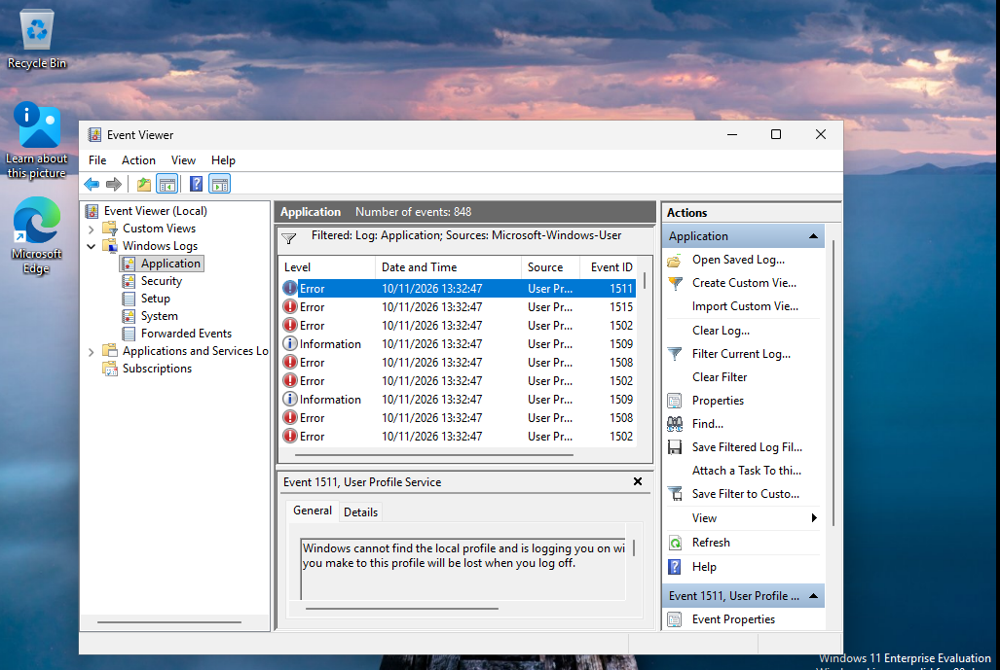
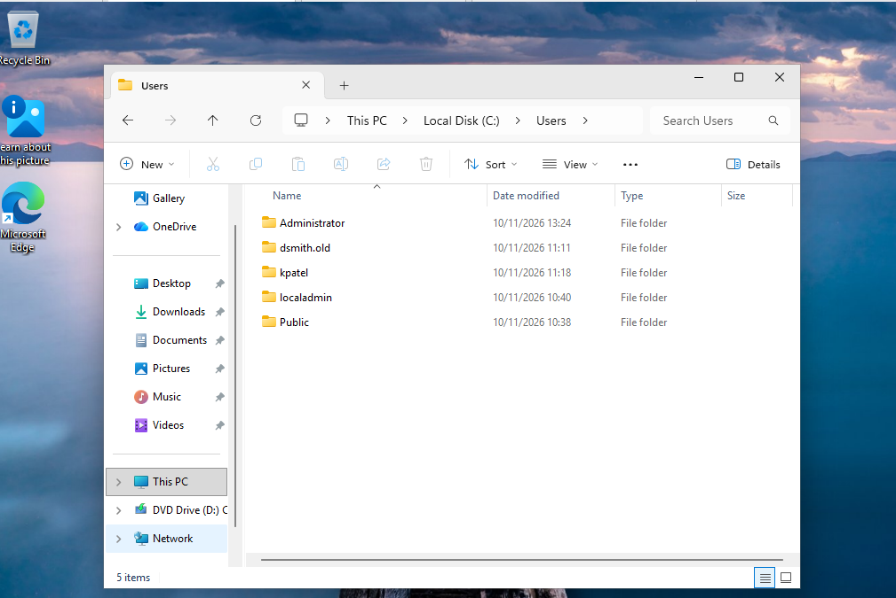
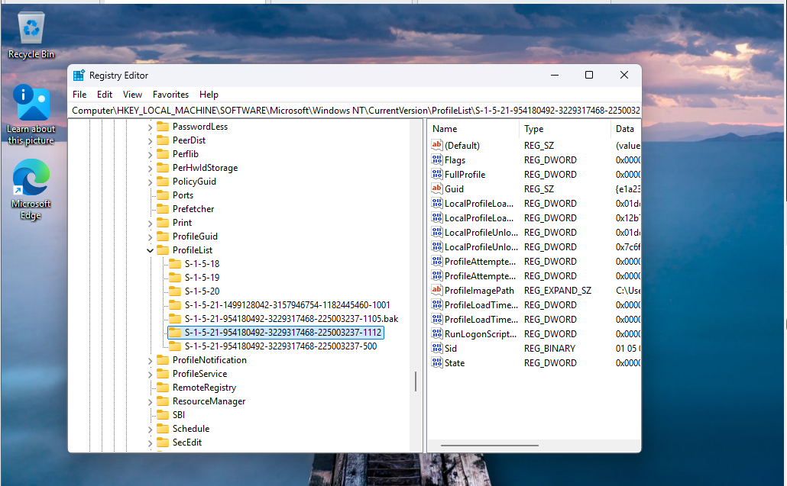
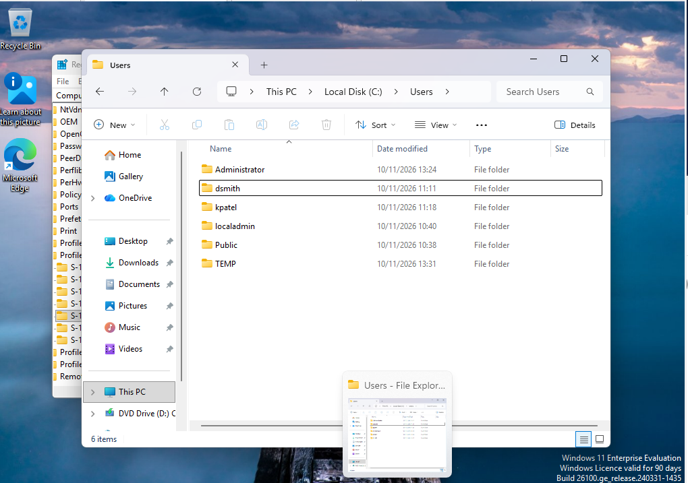
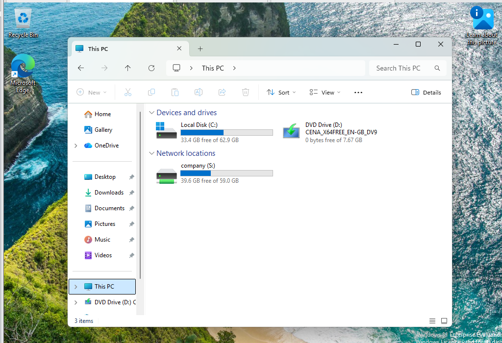
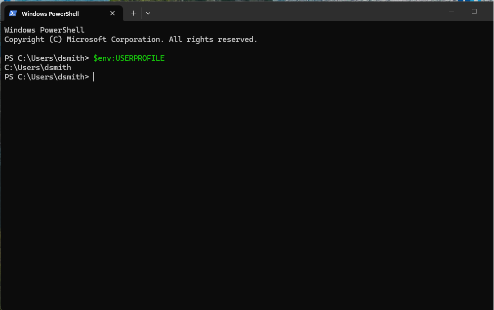

# Fault 1: Corrupt user profile (INC-001)

**Summary:** a user signed in and found an empty desktop and missing files. Windows had loaded a temporary profile because the user's profile folder no longer matched its registry entry. I restored the registry key and folder, and the user's data came back intact.

## Ticket

| Field | Entry |
|---|---|
| Ticket | INC-001 |
| User / device | Daniel Smith (LAB\dsmith) / WS01 |
| Priority | P3: single user, working but unable to access their files |
| Reported symptom | *"We can't sign in to your account"* on sign-in; desktop and Documents empty: "all my files are gone" |
| Triage questions | When did it start? What changed? Does it happen on another PC? Is anyone else affected? |
| Evidence | Event IDs **1511**, **1515**, **1508/1502** (User Profile Service). ProfileList key `S-1-5-21-…-1105` renamed to `.bak`, ProfileImagePath = `C:\Users\dsmith`, but that folder didn't exist |
| Root cause | Profile folder had been renamed to `dsmith.old`, so the registry path no longer matched and Windows fell back to a temporary profile |
| Resolution | 1. Confirmed which SID key belonged to dsmith (`-1112` belonged to another user and was left alone). 2. Removed `.bak` from the key name and set `State` to 0. 3. Renamed the folder back to `dsmith`. 4. Restarted. 5. Deleted the leftover `C:\Users\TEMP` folder |
| Verification | User signs in normally, `$env:USERPROFILE` = `C:\Users\dsmith`, `S:` drive mapped |
| Prevention | Never rename or delete profile folders by hand. Remove profiles via **System Properties → Advanced → User Profiles**, which also cleans up the registry |

## How the fault was reproduced

As an administrator, I renamed `C:\Users\dsmith` to `C:\Users\dsmith.old` while the user was signed out. This simulates a profile folder being deleted, moved or corrupted.

## Symptom (user's view)

A useful clue: the `S:` drive still mapped. That showed the user's account and Group Policy were fine, so the problem was isolated to the profile on this PC.

## Diagnosis

**Event Viewer → Windows Logs → Application**, filtered on *User Profile Service*:

| Event ID | Meaning |
|---|---|
| 1511 | Windows cannot find the local profile, so it signs the user in with a temporary profile |
| 1515 | Windows has backed up the user's profile registry key (renamed to `.bak`) |
| 1508 / 1502 | Failed to load the profile's registry hive (NTUSER.DAT) |

**Registry:** `HKLM\SOFTWARE\Microsoft\Windows NT\CurrentVersion\ProfileList` showed dsmith's key renamed with a `.bak` suffix. Its ProfileImagePath pointed to `C:\Users\dsmith`, which was missing; the data was sitting in `dsmith.old`.

## Fix and verification

## What I learned

- Event IDs 1511 and 1515 together point straight to a profile path or registry mismatch.
- Always confirm which SID belongs to which user before editing ProfileList. Here there were two similar keys and only one was dsmith's.
- "Sign out and back in", which the error box suggests, doesn't fix this. It's why it becomes a ticket.
