# Fault 2: Print server down (INC-002)

**Summary:** users could not print. No error was shown and nothing appeared in the queue. I worked from the client outwards, confirmed a second user was affected, and traced it to the Print Spooler being stopped and disabled on the print server (DC01). The event log identified when it happened and which account did it.

## Setup (working state)

A shared printer on DC01, deployed to all Staff users with Group Policy.

```powershell
Add-PrinterDriver -Name "Generic / Text Only"
Add-PrinterPort -Name "NUL"
Add-Printer -Name "Office-Printer" -DriverName "Generic / Text Only" -PortName "NUL" -Shared -ShareName "Office-Printer"
```

- `NUL` port: there's no physical printer, so jobs are discarded. That counts as "printed" in the lab.
- GPO **Printers - Office** (linked to Staff OU): User Configuration → Preferences → Printers → Shared printer `\\DC01\Office-Printer`, Action Update, set as default.

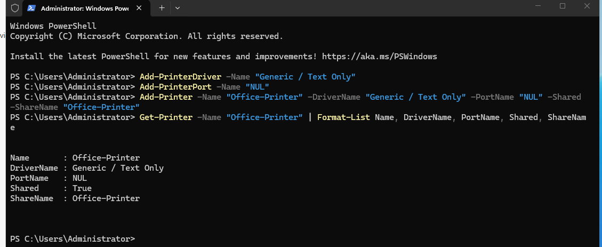
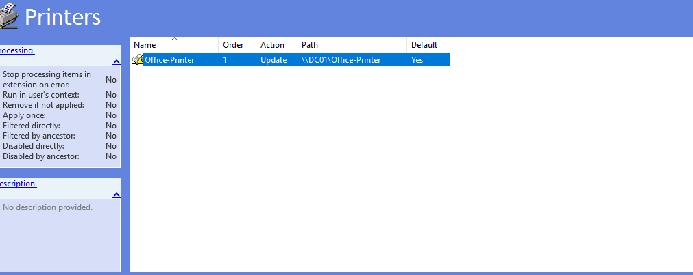
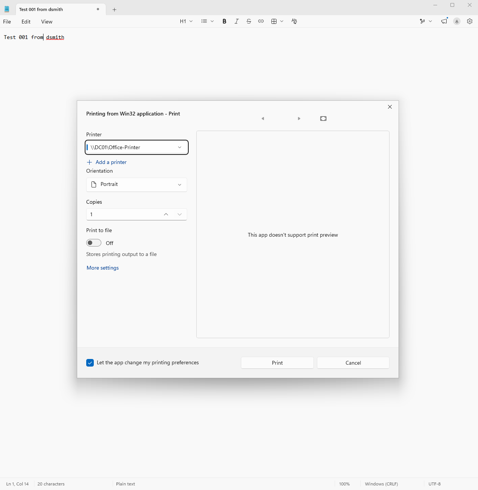

> Real-world note: you wouldn't share printers from a domain controller. Microsoft advises disabling the Print Spooler on DCs because of PrintNightmare-class vulnerabilities. A dedicated print server is the right design; the DC is used here to keep the lab small.

## Ticket

| Field | Entry |
|---|---|
| Ticket | INC-002 |
| Users / device | Daniel Smith (LAB\dsmith) and Kiran Patel (LAB\kpatel) / WS01 |
| Priority | **P2**: affects everyone printing via DC01, no workaround |
| Reported symptom | *"I printed my document but nothing came out."* No error, nothing in the queue. Second user: clicking the printer did nothing |
| Triage | Started this afternoon · **others affected too** · S: drive still opens (network to server OK) |
| Root cause | Print Spooler on the **print server (DC01)** stopped and set to Disabled by an admin account |
| Resolution | `Set-Service Spooler -StartupType Automatic` → `Start-Service Spooler` |
| Verification | Printer visible at `\\DC01` again; test print OK as dsmith; second user (kpatel) can query the printer |
| Prevention | Change control for server services; monitor Spooler status on print servers; use a dedicated print server |

## Diagnosis: working from the client outwards

**1. Client view, which turned out to be misleading.** WS01 still showed the printer as *Normal*. That status is cached from the last contact, so it can't be trusted on its own.

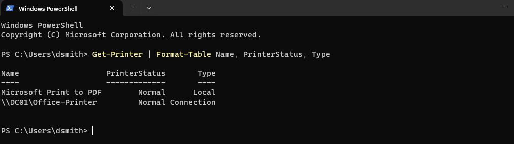

**2. Rule out the network and the client.** SMB to DC01 succeeded and WS01's own spooler was running.

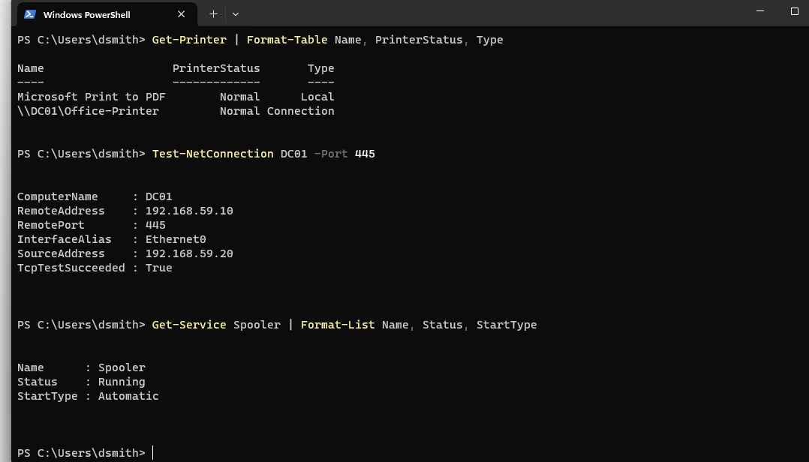

**3. Is it everyone?** A second user got a clear error naming the cause: *"The spooler service is not reachable."* Error `0x800706BA` means "RPC server unavailable". That's a server-side fault, not dsmith's PC.

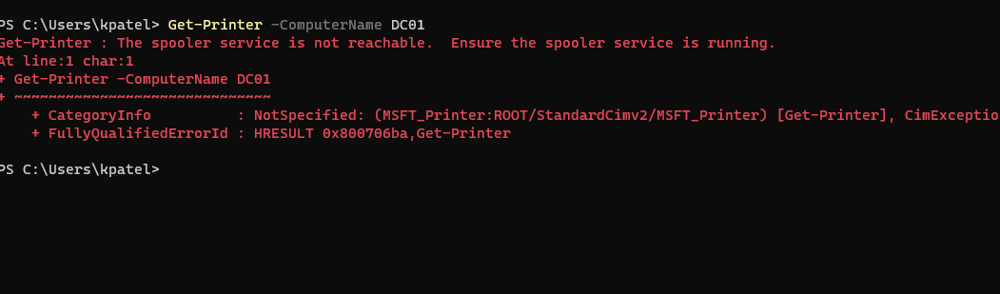

**4. The server.** After confirming with `hostname` that I was on DC01, the Print Spooler was **Stopped / Disabled**.

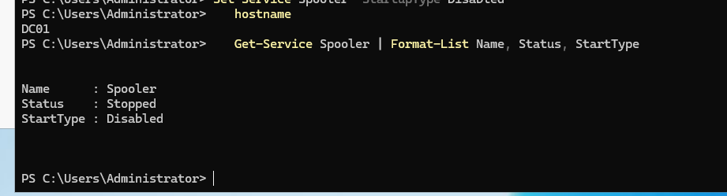

**5. Who and when.** System log, **Event ID 7040**: start type changed *auto start → disabled* by **LAB\Administrator** at 16:40:53. Event 7036 recorded the service stopping.

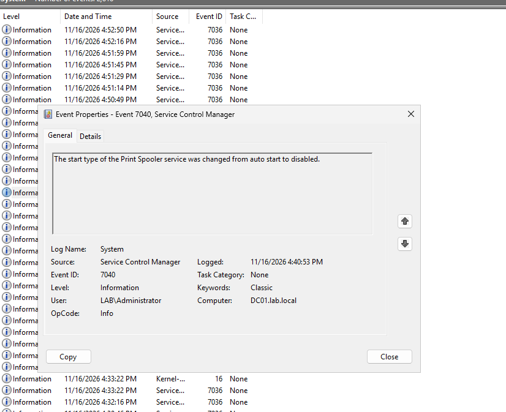

## Fix and verification

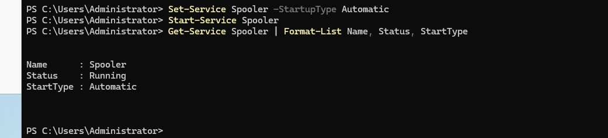
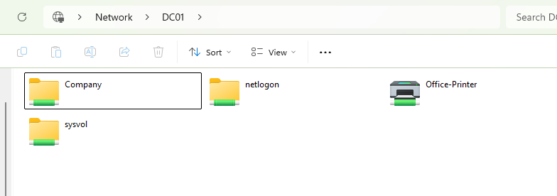
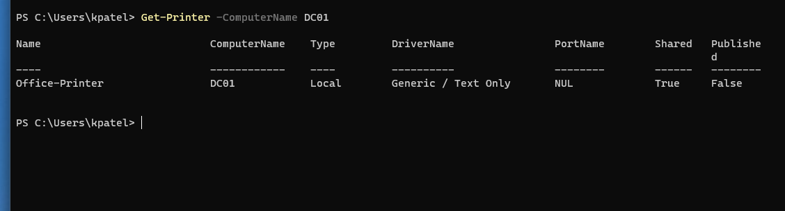

## What I learned

- **"One user or everyone?"** is the fastest way to tell a client fault from a server fault.
- Client-side status can be cached. Test the actual function, not just the list.
- Run `hostname` before a command. I originally meant to break the client and ran the command on the server instead, which turned into a more realistic fault.
- Event 7040 doesn't just show a service changed. It records **which account** changed it.
