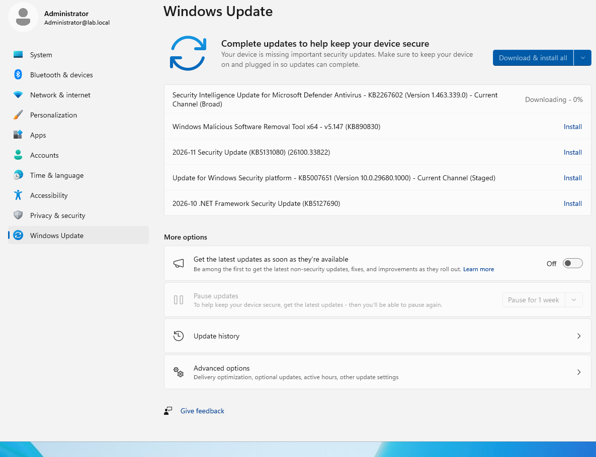
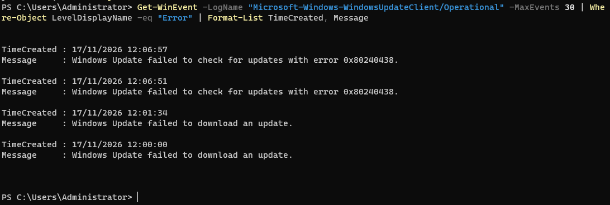
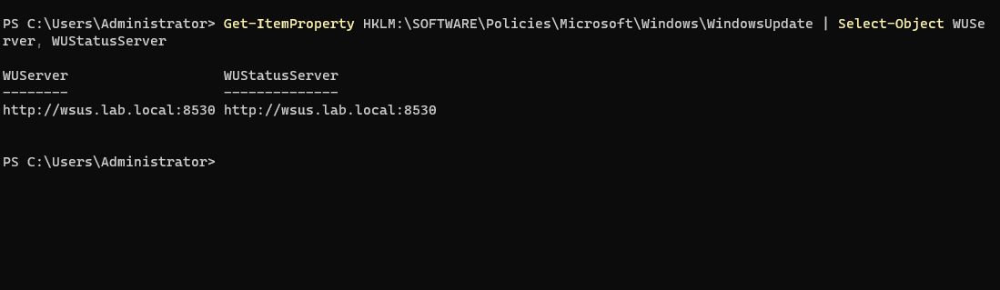
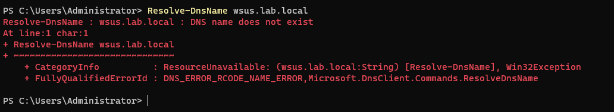
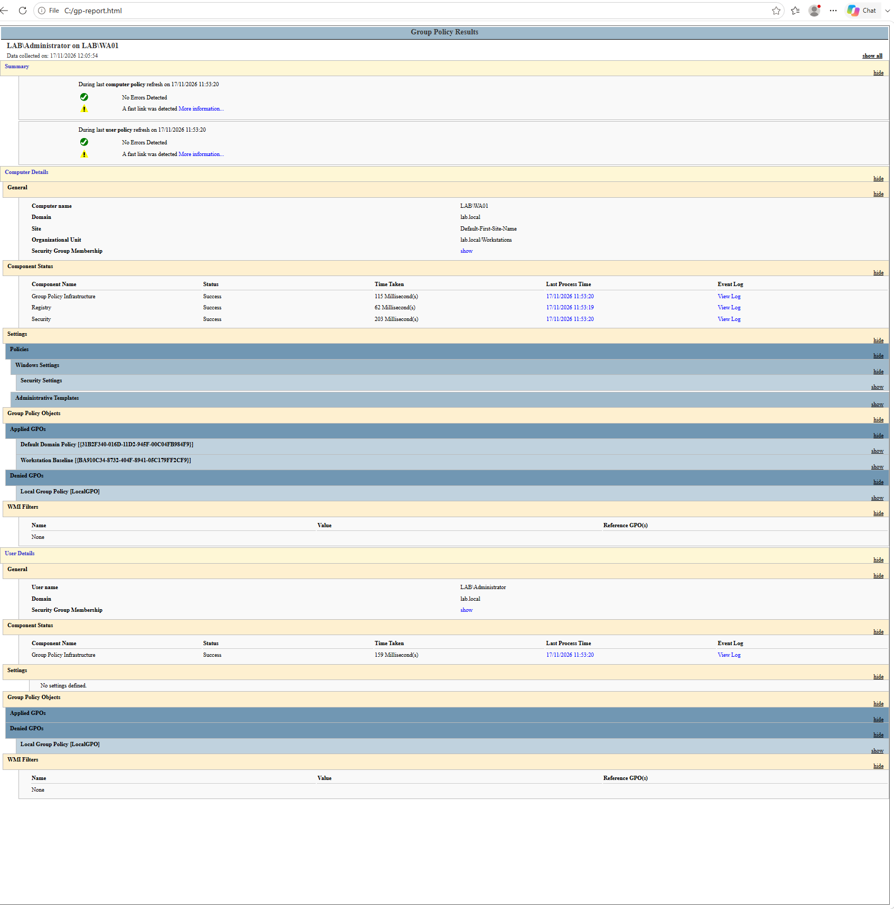
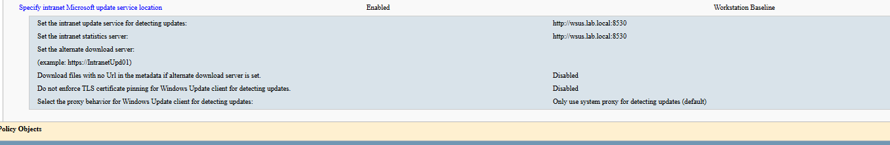
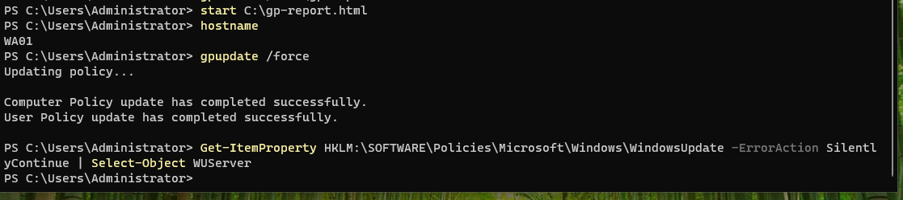
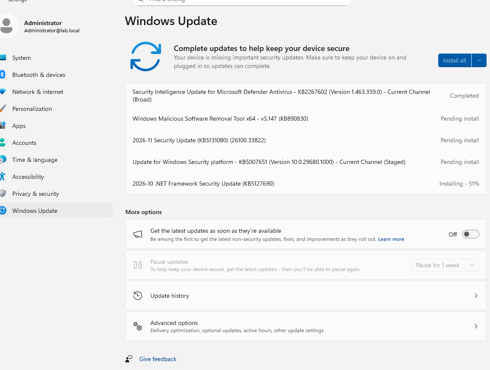

# Fault 3: Windows Update blocked by Group Policy (INC-003)

**Summary:** Windows Update stopped working on a domain workstation. I traced the error code to a policy setting in the registry, proved the target server didn't exist, and used `gpresult` to find the exact GPO responsible. Then I fixed it at the source in Group Policy rather than patching the client.

> Note: the client in this fault is named **WA01**, a typo made during the original build. It was renamed to WS01 afterwards under change record [CHG-001](../../README.md).

## How the fault was created

A GPO with a deliberately vague name, **Workstation Baseline**, was linked to the Workstations OU. It pointed Windows Update at an internal WSUS server that doesn't exist and blocked Microsoft's servers:

- Computer Configuration → Policies → Administrative Templates → Windows Components → Windows Update → Manage updates offered from Windows Server Update Service
  - *Specify intranet Microsoft update service location* = `http://wsus.lab.local:8530`
  - *Do not connect to any Windows Update Internet locations* = Enabled

Baseline before the fault: Windows Update found updates normally.

## Ticket

| Field | Entry |
|---|---|
| Ticket | INC-003 |
| Device | WA01 (lab.local/Workstations) |
| Priority | **P3**: updates blocked (a security risk if left), no immediate user outage |
| Reported symptom | "Updates failed": download error **0x8024500C**; settings show *"managed by your organisation's policy"* |
| Root cause | GPO *Workstation Baseline* pointed clients at a non-existent WSUS server and blocked the fallback to Microsoft |
| Resolution | Set both Windows Update policy settings to **Not Configured** in the GPO |
| Verification | Policy registry value gone on WA01; updates downloading and installing again |
| Prevention | Change control and pilot-OU testing for GPOs; descriptive GPO names; confirm a WSUS server exists before pointing clients at it |

## Diagnosis

**1. The error code.** The Windows Update log on WA01 showed download failures at 12:00 and 12:01, then failed update checks with **0x80240438** (endpoint unreachable).

**2. The registry.** Under `HKLM\SOFTWARE\Policies\Microsoft\Windows\WindowsUpdate`, WA01 was pointed at `http://wsus.lab.local:8530`. Anything under `\Policies\` is written by Group Policy, not by a user.

**3. Does that server exist?** No. DNS returned *"DNS name does not exist"*.

**4. Which GPO did it?** `gpresult /h` on WA01 showed the policies applied to the Workstations OU, and the **Winning GPO** for the WSUS setting: **Workstation Baseline**.

## Fix and verification

Fixed **at the source**: both settings in *Workstation Baseline* were set to **Not Configured**. Deleting the registry value on the PC wouldn't have lasted, because Group Policy re-applies settings at the next refresh (about every 90 minutes).

On WA01, after `gpupdate /force` (with `hostname` run first to confirm the machine), the policy value was gone:

Windows Update could reach Microsoft again and started installing:

## What I learned

- Start with the **error code**: 0x8024500C and 0x80240438 both pointed to a connectivity or policy problem, not a broken update.
- `HKLM\SOFTWARE\Policies\` means **Group Policy**, and `gpresult /h` names the **winning GPO**.
- Fix the GPO, not the symptom on one PC.
- Run `hostname` before every command. One verification step was first run on the server by mistake and had to be redone on the client.
